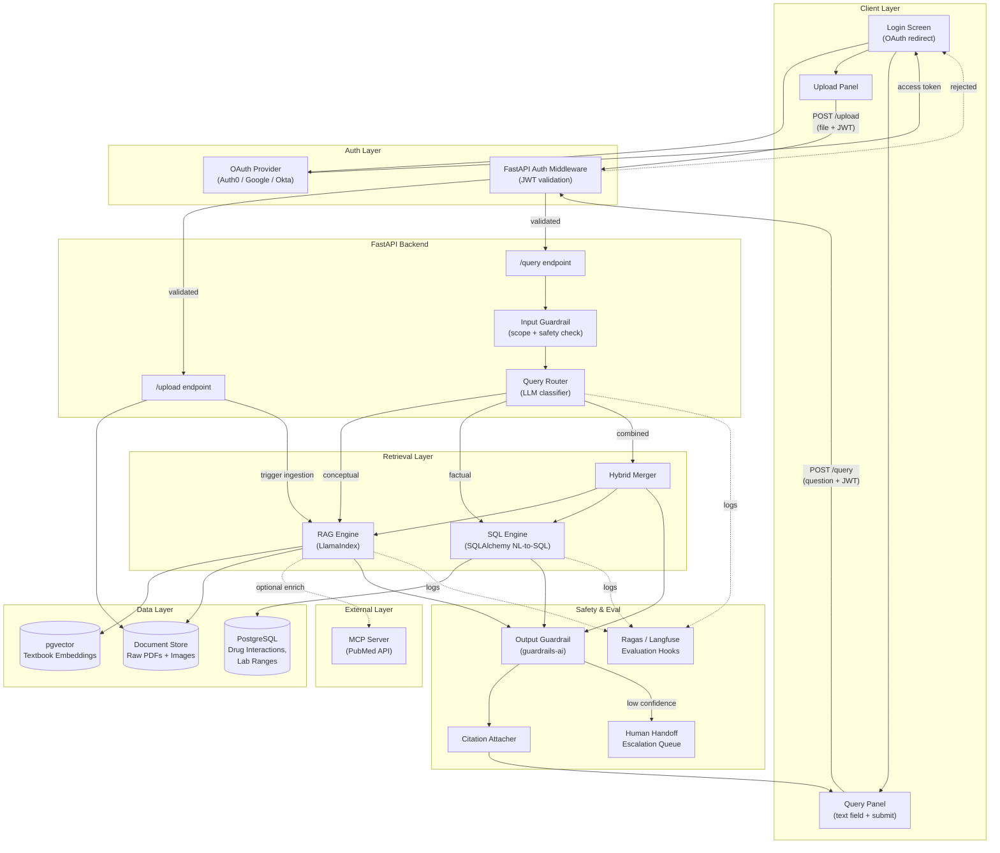
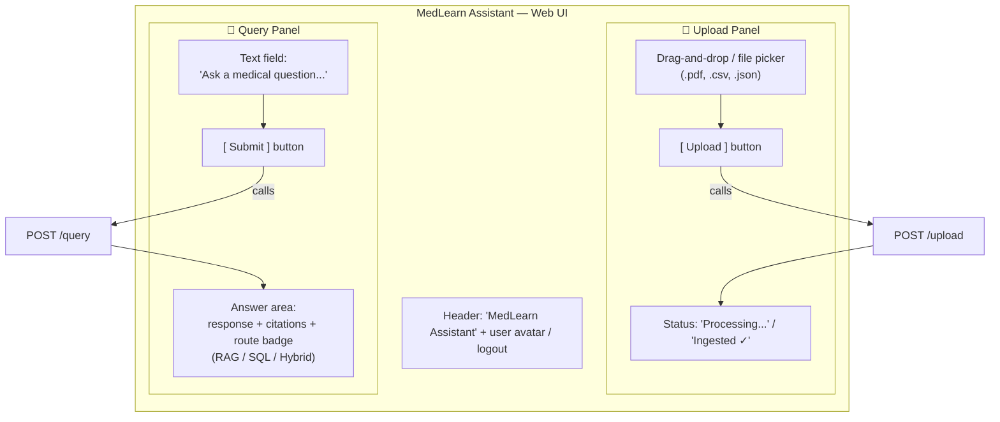
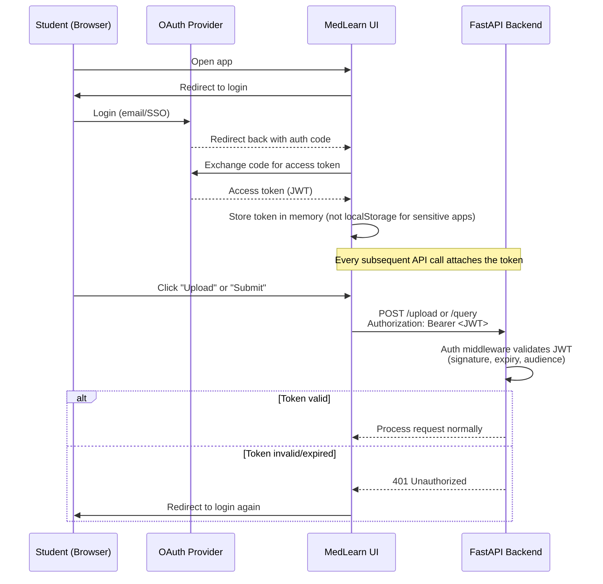
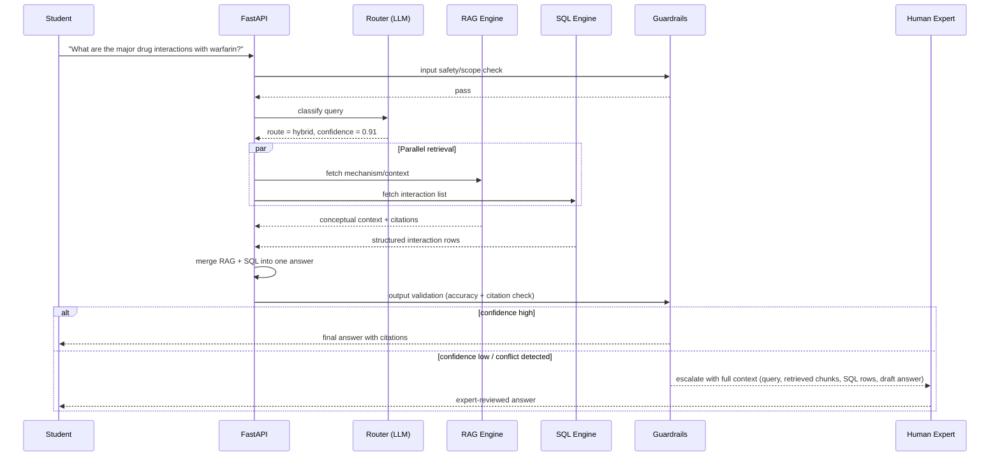
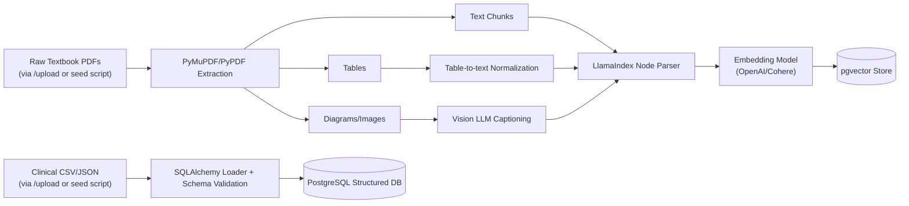

# MedLearn Assistant — 1-Week Project Plan
### AI-Powered Medical Education Companion (RAG + SQL Hybrid System)

**Team size:** 3 members | **Duration:** 7 days | **Core framework:** LlamaIndex + FastAPI + pgvector

---

## 1. Problem Statement

Medical students need to do two very different things when they study:

1. **Understand concepts** — anatomy, physiology, pathology explained in dense textbook prose, diagrams, and tables.
2. **Look up facts** — drug interactions, lab reference ranges, contraindications — data that must be exact, not "approximately right."

Today these live in separate tools. A student either searches a textbook (slow, manual) or a clinical database (no explanations). Nothing combines the two, and nothing decides *automatically* which type of question they're asking.

**Core problem to solve:** Build a system that takes a natural-language medical question, figures out whether it needs conceptual retrieval (RAG), a deterministic database lookup (SQL), or both — then answers it accurately, with citations, safety guardrails, and a path to a human expert when confidence is low. It also needs a simple, authenticated UI so students can actually upload course material and ask questions, rather than only calling the API directly.

---

## 2. Proposed Solution

A **hybrid Retrieval-Augmented Generation system** with an intelligent router sitting in front of two retrieval engines, fronted by a lightweight web UI that handles document ingestion, question submission, and secure login.

| Question type | Example | Engine used |
|---|---|---|
| Conceptual | "Explain the difference between rapidly and slowly adapting receptors" | RAG (vector search over textbook) |
| Factual/deterministic | "What is the normal range for serum potassium?" | SQL (structured clinical DB) |
| Combined | "Explain warfarin's mechanism and list its major drug interactions" | Hybrid (RAG + SQL, merged) |

The router is the differentiator here — it's what turns this from "a chatbot over a PDF" into a production-grade system. The UI and OAuth layer are what make it usable and secure for real students rather than a backend-only demo.

**Guiding principle for the week:** build the thinnest possible end-to-end path first (ingest → route → retrieve → answer) and only then layer in the UI, OAuth, multi-modal parsing, guardrails, evaluation, and handoff. A working skeleton on Day 3 beats a perfect RAG pipeline that has no router, no UI, and no auth by Day 7.

---

## 3. System Architecture

**Key architectural decisions:**
- **Router = an LLM call with a structured output** (not a keyword classifier). It returns `{route: "rag" | "sql" | "hybrid", confidence: float, reasoning: str}`. Low confidence routes to human handoff regardless of which engine would have been chosen.
- **RAG engine** uses LlamaIndex's multi-modal ingestion: text chunks go through standard embedding; tables are parsed into markdown-like text before chunking; diagrams are captioned via a vision-capable LLM call at ingestion time and the caption is embedded alongside the image reference.
- **SQL engine** uses an NL-to-SQL chain (LlamaIndex's `NLSQLTableQueryEngine` or a hand-rolled SQLAlchemy layer) constrained to a fixed, documented schema — this keeps it deterministic and auditable, which matters for medical facts.
- **Guardrails** run twice: once on input (reject out-of-scope or unsafe requests, e.g. dosage requests for self-treatment) and once on output (flag hallucinated claims, missing citations, or contradictions with the SQL source of truth).
- **Auth sits in front of every endpoint.** `/upload` and `/query` both require a valid JWT issued by the OAuth provider; the FastAPI middleware validates it before any request reaches the router or ingestion logic.

---

## 4. UI Design — Upload & Query Interface

A minimal two-panel single-page UI, gated behind login. Kept intentionally simple for a one-week build — functional over polished.

**Behavior spec:**

| Element | Action | Endpoint called |
|---|---|---|
| Upload panel: file picker + **Upload** button | User selects a textbook PDF or structured clinical file and clicks Upload | `POST /upload` — multipart file upload; attaches the user's JWT in the `Authorization` header; backend triggers the ingestion pipeline (Section 6) and returns an ingestion status/job ID |
| Query panel: text field + **Submit** button | User types a natural-language question and clicks Submit | `POST /query` — JSON body `{ "question": "<text>" }`; attaches the user's JWT; backend runs input guardrail → router → RAG/SQL/Hybrid → output guardrail → returns `{ answer, citations, route, confidence }` |
| Answer area | Displays the returned answer, citation list, and a small badge showing which route (RAG/SQL/Hybrid) answered the question — useful for grading/demo purposes | — |
| Header | Shows logged-in user and a logout button that clears the token and redirects to login | Logout clears local token; no backend call needed unless token revocation is implemented |

**Notes for a one-week build:**
- A single React (or plain HTML/JS) page is enough — no routing library needed, just two panels and a login gate.
- The **Submit** button should be disabled while a request is in flight, and the answer area should show a loading state, since RAG/hybrid queries may take a few seconds.
- File upload should show basic client-side validation (file type/size) before hitting `/upload`, to avoid wasting ingestion time on bad files.

---

## 5. OAuth Integration Flow (UI → Backend)

**Implementation notes:**
- Use the OAuth **Authorization Code flow** (with PKCE if the UI is a public single-page app) rather than the implicit flow, since it's the current recommended practice for browser-based apps.
- The FastAPI backend only needs to **validate** tokens (verify signature against the provider's public keys, check expiry and audience) — it does not need to manage user credentials itself.
- Both `/upload` and `/query` should sit behind a shared `require_auth` dependency in FastAPI so the auth check is centralized rather than repeated per-route.
- For the one-week timeline, a hosted OAuth provider (Auth0, Firebase Auth, or Okta's free tier) is strongly preferred over rolling a custom auth server — it removes an entire category of work from the schedule.

---

## 6. Query & Upload Workflow (Sequence)

---

## 7. Data & Ingestion Pipeline

Triggered by the UI's **Upload** button via `POST /upload`, or by a batch script for the initial seed dataset.

---

## 8. One-Week Plan of Action (3 Members)

**Team roles for the week:**
- **Member A — Ingestion & RAG Lead:** owns document processing, multi-modal parsing, vector store, RAG engine, and exposing ingestion as a callable service for `/upload`.
- **Member B — Structured Data & Routing Lead:** owns SQL database, NL-to-SQL engine, query router, hybrid merge logic.
- **Member C — API, UI, Auth & Eval Lead:** owns FastAPI backend, the web UI (upload + query panels), OAuth integration, guardrails, MCP integration, evaluation harness, human handoff, documentation.

All three sync briefly each morning (15 min) to unblock dependencies — the router (B) needs the RAG and SQL engines' interfaces (A, B) defined by Day 2, the UI (C) needs the `/query` and `/upload` contracts defined by Day 1, and guardrails/eval (C) need real outputs to test against from Day 3 onward.

| Day | Member A (Ingestion & RAG) | Member B (Structured Data & Routing) | Member C (API, UI, Auth & Eval) |
|---|---|---|---|
| **Day 1** | Set up PostgreSQL + pgvector; collect sample textbook chapter(s); build PDF extraction pipeline (text + tables + images) with PyMuPDF | Design SQL schema for drug interactions, lab ranges, contraindications; source/curate sample structured dataset; set up PostgreSQL tables | Scaffold FastAPI project (`/upload`, `/query` route stubs) and shared Pydantic schemas; scaffold minimal UI shell (login screen, upload panel, query panel — no live wiring yet); set up repo, env vars, `.env` template |
| **Day 2** | Build LlamaIndex ingestion: chunking, embedding, load into pgvector; caption diagrams via vision LLM call; normalize tables to text | Load structured data into DB; build first NL-to-SQL query engine; test 5–10 factual queries end-to-end against DB | Implement query router (LLM classifier returning route + confidence); wire UI's Submit button to `/query` against a stubbed response so the UI flow is testable early |
| **Day 3** | Wire RAG engine into FastAPI as callable service; test conceptual queries end-to-end; tune retrieval (top-k, chunk size) | Wire SQL engine into FastAPI; implement hybrid merge logic (combine RAG context + SQL rows into one prompt for final answer synthesis) | Integrate router + RAG + SQL into the `/query` endpoint; connect UI Submit button to the real endpoint end-to-end; add loading/answer-display states in UI |
| **Day 4** | Refactor ingestion pipeline into a callable service function (not just a script) so it can be triggered by `/upload`; improve multi-modal retrieval quality; add citation metadata (source page, section) to every chunk | Add schema documentation + query validation/sanitization (prevent malformed SQL); expand structured dataset coverage | Set up OAuth provider (e.g. Auth0) and build the login screen + token exchange in the UI; implement FastAPI auth middleware (JWT validation) but don't enforce it on endpoints yet |
| **Day 5** | Support C on wiring `/upload` to the ingestion service; polish citation formatting in responses | Add confidence scoring to hybrid answers; stress-test router against ambiguous queries; refine routing prompt based on Day 3–4 failures | Wire `/upload` endpoint to Member A's ingestion service; enforce auth middleware on both `/upload` and `/query`; add input guardrail (scope/safety check) and output guardrail (guardrails-ai); begin MCP integration for PubMed lookups |
| **Day 6** | Run end-to-end test set of 15–20 sample queries across all 3 routes; fix retrieval gaps found in testing | Run end-to-end test set focused on SQL/hybrid accuracy; fix routing misclassifications found in testing | Finish MCP integration; build human handoff workflow; run full end-to-end test of the UI flow (login → upload → query → answer) with real auth tokens; set up evaluation harness (Ragas/Langfuse) and compile benchmark results |
| **Day 7** | Finalize architecture documentation (ingestion + RAG sections); record short demo of conceptual queries | Finalize routing logic documentation; record short demo of factual + hybrid queries | Compile full documentation (architecture diagram, UI/OAuth flow, API docs, deployment guide, SLO benchmark report); assemble final demo including the login → upload → query walkthrough |

---

## 9. RAG Design Considerations Baked Into the Plan

- **Chunking strategy:** semantic chunking per section/subsection rather than fixed token windows, since textbook content has natural hierarchical structure (chapter → section → paragraph) that LlamaIndex's node parser can respect.
- **Multi-modal handling:** treat diagram captions as first-class retrievable text (embedded alongside prose) rather than bolting image search on separately — this keeps the retrieval index single and simple for a one-week timeline.
- **Retrieval quality over quantity:** start with top-k = 3–5 and a re-ranking step only if time allows on Day 4–5; don't over-engineer retrieval before the router and guardrails exist.
- **Citations as a first-class field:** every chunk carries `{source, page, section}` metadata from ingestion so the citation attacher never has to reconstruct provenance after the fact.
- **Guardrails tied to the SQL source of truth:** when RAG and SQL disagree on a factual claim (e.g., a dosage number), the output guardrail should prefer SQL and flag the discrepancy for human review rather than silently picking one.

---

## 10. Minimum Viable Deliverable by End of Week 1

1. Working `/query` and `/upload` APIs that correctly route/answer all three query types (RAG, SQL, hybrid) with citations, and correctly ingest new documents.
2. A minimal, authenticated web UI with an upload panel (calling `/upload`) and a query panel with a text field and Submit button (calling `/query`), gated behind OAuth login.
3. Ingested sample dataset: one textbook chapter (Somatosensory System) + one structured clinical dataset (drug interactions, lab ranges).
4. Input/output guardrails active, with at least one demonstrated escalation to human handoff.
5. Basic evaluation report: retrieval accuracy, routing accuracy, and latency against a defined SLO (e.g., p95 latency < 5s).
6. Documentation package: architecture diagram, UI/OAuth flow diagram, workflow diagram, API docs, and a short deployment guide.

Anything beyond this (full PubMed/MCP enrichment, advanced re-ranking, token refresh/rotation, a more polished frontend) is a stretch goal for Day 6–7 if the core path is stable early.
