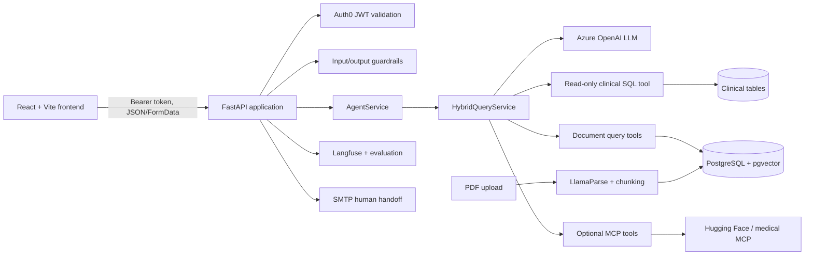
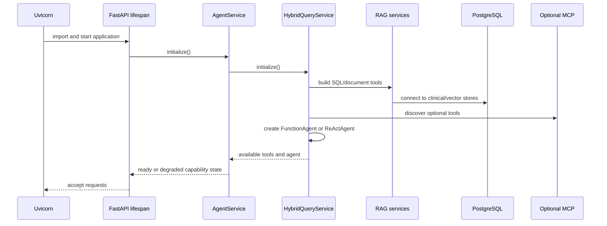
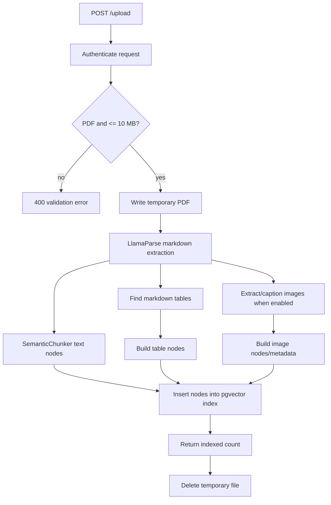
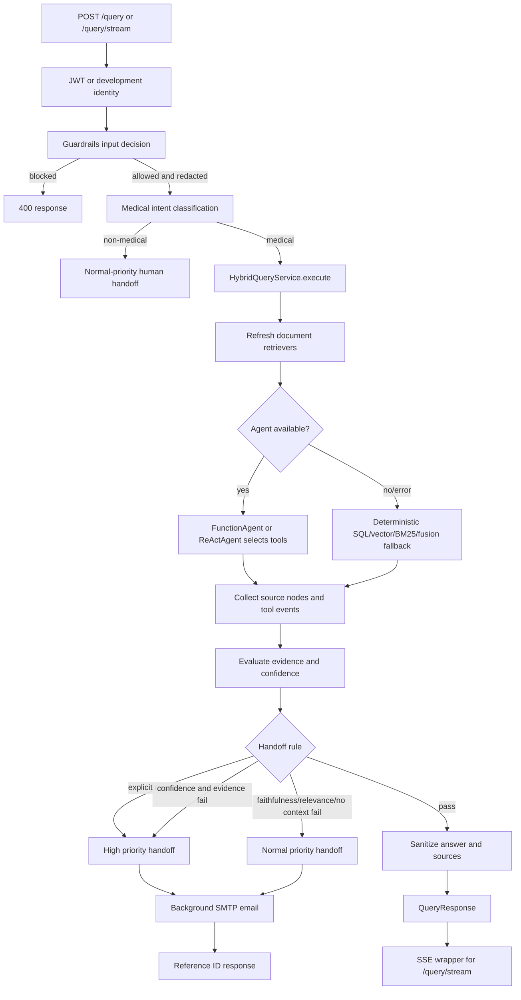

# MedLearn Assistant Implementation Guide

## 1. Purpose and Scope

MedLearn Assistant is a medical-education assistant that combines uploaded course material, structured clinical data, and optional external tools. Its primary contract is a FastAPI API consumed by a React/Vite client.

The system is designed for educational support, not diagnosis or treatment. Answers must be grounded in available evidence, sanitized for sensitive information, and escalated to a human reviewer when evidence or confidence is insufficient.

This document describes:

- The architecture that is implemented in the repository.
- Runtime workflows for startup, document ingestion, querying, streaming, and handoff.
- The technology stack and module responsibilities.
- Coding, API, security, observability, testing, and deployment standards.
- Known implementation gaps that should be resolved before calling the system production-ready.

## 2. Current Architecture



### Runtime boundaries

| Boundary | Responsibility | Main implementation |
|---|---|---|
| HTTP/API | Validation, authentication, CORS, response shaping | `backend/main/app.py`, `backend/main/routes/routes.py` |
| Application façade | Lifecycle and query entry point | `backend/main/service/agent_service.py` |
| Agent orchestration | Tool construction, tool calling, fallbacks, evaluation | `backend/main/service/hybrid_query_service.py` |
| Document retrieval | Vector, BM25, and fusion retrieval | `backend/main/service/rag_service.py`, `fusion_retrieval.py` |
| Query routing | Deterministic retriever classification for fallback and legacy paths | `backend/main/service/query_router.py` |
| Structured retrieval | Allow-listed natural-language SQL | `hybrid_query_service.py` |
| Safety | PHI/PII redaction, jailbreak and destructive-request blocking | `backend/main/service/guardrails.py` |
| Human review | Threshold decisions and SMTP notification | `backend/main/handoff/handoff_service.py` |
| Observability | Structured logs, Langfuse traces, scores | `backend/main/logs`, `evaluation`, `observability` |
| Client | Authenticated chat, SSE display, upload UI | `frontend/src/App.tsx`, `frontend/src/services` |

## 3. Technology Stack

### Backend

- Python 3.12.
- FastAPI 0.121 and Uvicorn.
- Pydantic 2 for request and response models.
- LlamaIndex Core for agents, query engines, tools, nodes, and workflows.
- Azure OpenAI for the chat model and embeddings.
- PostgreSQL with pgvector for document embeddings and metadata.
- SQLAlchemy and `psycopg2`/`psycopg` for database access.
- LlamaParse for PDF-to-markdown extraction.
- BM25 plus vector retrieval and reciprocal-rank fusion.
- Guardrails AI and fallback regular-expression redaction for sensitive data.
- Auth0-compatible JWT validation using `python-jose`.
- Langfuse for traces, evaluations, and scores.
- MCP clients for optional Hugging Face and medical-literature tools.
- SMTP for human-handoff email delivery.
- `uv` for Python dependency and environment management.

### Frontend

- React 19 with TypeScript.
- Vite for development and production bundling.
- Auth0 React SDK for login and access-token acquisition.
- Native `fetch` for API calls and Server-Sent Events parsing.
- ESLint and TypeScript build checks.

### Infrastructure

- A PostgreSQL instance with the pgvector extension.
- The structured schema in `medical_database_schema.sql`.
- Azure OpenAI deployments for chat and embeddings.
- Optional LlamaCloud/LlamaParse, Langfuse, Hugging Face, Auth0, and SMTP accounts.

## 4. Repository Structure

```text
medlearn-assistant/
|-- backend/
|   |-- main.py                         # Backend launch compatibility entry point
|   |-- main/
|   |   |-- app.py                      # FastAPI app and lifespan
|   |   |-- routes/routes.py             # HTTP endpoints and handoff policy
|   |   |-- schema/models.py             # Pydantic API contracts
|   |   |-- security/security.py         # JWT validation helpers
|   |   |-- service/
|   |   |   |-- agent_service.py         # Application façade
|   |   |   |-- hybrid_query_service.py  # Agent and tool orchestration
|   |   |   |-- rag_service.py            # Index initialization and ingestion
|   |   |   |-- fusion_retrieval.py       # Vector/BM25 retrieval
|   |   |   |-- query_router.py           # Deterministic routing
|   |   |   |-- mcp_client.py             # Remote MCP client adapters
|   |   |   |-- guardrails.py             # Input/output safety checks
|   |   |   |-- metadata.py               # Medical metadata extraction
|   |   |   `-- ...
|   |   |-- handoff/handoff_service.py   # Escalation rules and email
|   |   |-- evaluation/                  # RAG scoring and datasets
|   |   |-- observability/               # Tracing infrastructure
|   |   |-- tools/custom_tools.py        # Local Hugging Face inference tool
|   |   `-- test/                        # Unit and integration tests
|   |-- pyproject.toml
|   `-- stored_images/                   # Generated document assets, if enabled
|-- frontend/
|   |-- src/App.tsx                     # Auth, chat, upload, admin views
|   |-- src/services/api.ts              # Authenticated HTTP wrapper
|   |-- src/services/chat.ts             # Query and SSE client
|   |-- src/services/documents.ts        # Upload client
|   `-- package.json
|-- medical_database_schema.sql
|-- sample queries.md
`-- implementation.md
```

## 5. Startup and Dependency Initialization



Initialization is intentionally capability-oriented. Failure to create one database, document, or MCP tool should mark that capability unavailable and allow other tools to remain available. The API should still expose the individual tool errors through query metadata and logs.

## 6. Document Ingestion Workflow

The current live endpoint is PDF-only and has a 10 MB check in `routes.py`. The environment file contains broader format and size settings, but those settings are not currently applied by the route. Treat the route behavior as authoritative until the implementation is aligned.



### Ingestion rules

1. Validate the filename and file content before parsing.
2. Never use the client filename as a filesystem path. Use a temporary file and sanitized metadata.
3. Parse into structured nodes. Preserve source, page/sheet, content type, table/image references, and medical tags in node metadata.
4. Insert through the shared vector index and clear query-engine caches after an update.
5. Always delete the temporary upload in a `finally` block.
6. Do not log document contents or tokens. Log bounded sizes, identifiers, and processing timings.

## 7. Query Workflow



### Tool selection

The agent can use these local data tools:

- `clinical_sql`: read-only queries against the allow-listed clinical tables.
- `semantic_search`: conceptual and paraphrase-oriented document retrieval.
- `bm25_search`: exact terms, definitions, numbers, and named entities.
- `hybrid_document_search`: vector plus BM25 fusion for complex document questions.

Optional tools include Hugging Face Hub discovery/inference and medical-literature MCP tools. Hugging Face inference must follow search first, then select a returned model ID, then infer. The wrapper rejects guessed or malformed tool arguments.

The deterministic `QueryRouter` remains important for fallback behavior and the legacy path. It scores vector, BM25, and fusion patterns, with fusion as the conservative default when no strong pattern is found.

### Handoff policy

Current thresholds are:

- Faithfulness below `0.6`.
- Relevance below `0.5`.
- Source-aware confidence below `40/100` when used with a risky evidence result.

Priority order:

1. Explicit request for a human: high priority.
2. Low confidence combined with a score/retrieval failure: high priority.
3. Faithfulness, relevance, or empty-context failure: normal priority.
4. Otherwise return the guarded answer and sources.

The handoff payload includes a generated reference ID, trace ID, user email, question history, answer, evaluation scores, and retrieved chunks. Email delivery is background work and must not make a successful API response fail.

## 8. API Contracts

### `POST /query`

Request:

```json
{
  "question": "Explain how the somatosensory system detects touch.",
  "user_email": "learner@example.com"
}
```

Response fields include `answer`, `query`, `source_nodes`, `tools_used`, `tool_errors`, `routing`, and `validation_results`. `routing` is commonly `agent`, `fallback`, `handoff`, or an MCP-specific route.

### `POST /query/stream`

Returns `text/event-stream`. The current implementation executes the full query first and then emits answer chunks, followed by a `done` event containing the complete `QueryResponse`. This is transport streaming, not token streaming from the model.

### `POST /upload`

Accepts multipart field `file`. The current implementation accepts PDF files up to 10 MB and returns:

```json
{
  "message": "Document processed successfully",
  "documents_indexed": 12
}
```

### `GET /health`

Returns a lightweight process health response. It does not currently prove that PostgreSQL, Azure OpenAI, or MCP dependencies are healthy.

## 9. Frontend Workflow

1. Auth0 completes login and the app obtains an access token silently.
2. The token is sent as a Bearer token for API calls.
3. Chat uses `/query/stream`, appends SSE chunks to the assistant message, then replaces the partial message with the final response metadata.
4. Upload uses `FormData` and `/upload`; the UI currently validates PDF and 10 MB, matching the live route.
5. A 401 invokes the registered unauthorized handler and logs the user out.
6. Admin routing is based on the configured Auth0 role namespace; the current admin page is a placeholder workspace.

## 10. Implementation Standards

### Python

- Keep route handlers thin: authentication, validation, orchestration, and response mapping belong at the API boundary; retrieval and business rules belong in services.
- Use typed Pydantic models for external input/output and dataclasses for internal event/result records.
- Prefer async I/O for model, MCP, and SMTP-adjacent operations. Use `asyncio.to_thread` only for blocking library calls.
- Make optional dependencies degradable. Record the capability failure and preserve the remaining query path.
- Keep tool names, schemas, and descriptions explicit. Validate tool arguments at the boundary with `extra="forbid"` where possible.
- Use structured logs with component, operation, status, duration, and bounded metadata. Never log secrets, full prompts, PHI, or full uploaded documents.
- Preserve public response fields when changing internals. Add fields compatibly rather than renaming them without a migration.

### Retrieval and answer quality

- Select SQL for deterministic structured facts; select document retrieval for educational explanations; combine them only when the question needs both.
- Keep SQL table access allow-listed and read-only.
- Preserve source metadata through every transformation so citations and handoff context remain useful.
- Evaluate only against evidence that actually contributed to the answer. Do not score a SQL or MCP answer with document-only evaluators.
- Prefer escalation over unsupported medical claims.

### TypeScript/React

- Keep API calls in `frontend/src/services`, not inside reusable presentation components.
- Define response types at the API boundary and handle partial SSE responses explicitly.
- Keep authentication state and token acquisition in the app shell.
- Display source and validation metadata without exposing raw internal errors to end users.
- Keep upload restrictions synchronized with backend restrictions.

### Configuration

- Read configuration from environment variables at the boundary or in a dedicated settings object.
- Provide safe defaults only for local development. Require production secrets explicitly.
- Do not commit `.env` files or credentials. The current workspace attachment contains live-looking Langfuse, SMTP, Azure, Hugging Face, Auth0, and LlamaCloud credentials; rotate them immediately and replace them outside source control.
- Use separate development, test, and production databases and vector tables.

## 11. Testing Standard

Run focused checks before broad checks:

```powershell
# Backend
cd backend
uv run pytest

# Focused routing and safety tests
uv run pytest test/test_query_router.py test/test_guardrails.py test/test_query_scope.py

# Frontend
cd ..\frontend
npm run lint
npm run build
```

Minimum coverage for a feature:

- Pure routing or threshold logic: boundary and negative cases.
- API changes: request validation, auth behavior, response shape, and failure path.
- Retrieval changes: empty index, unavailable BM25, metadata preservation, and fallback behavior.
- Guardrail changes: PII redaction, destructive SQL requests, jailbreak text, and harmless medical questions.
- Handoff changes: explicit request, low scores, no context, SMTP unavailable, and reference ID format.
- Frontend changes: expired token, API error, SSE completion, upload rejection, and successful source rendering.

Integration tests requiring PostgreSQL, Azure, Langfuse, or MCP must be opt-in and clearly marked. Unit tests must use fakes or mocks rather than real credentials.

## 12. Deployment Runbook

1. Provision PostgreSQL and enable pgvector.
2. Apply `medical_database_schema.sql` to the structured clinical database.
3. Configure a separate vector table for uploaded document nodes.
4. Set Azure OpenAI endpoint, API key, API version, chat deployment, and embedding deployment.
5. Configure Auth0 values and set `AUTH_ENABLED=true` outside local development.
6. Configure CORS with exact frontend origins.
7. Configure SMTP only if human handoff email is required.
8. Configure Langfuse and optional MCP integrations.
9. Install backend dependencies with `uv sync` and run Uvicorn.
10. Install frontend dependencies with `npm install`, build with `npm run build`, and serve the generated Vite output.
11. Verify `/health`, authenticated `/query`, PDF upload, source display, and a forced handoff in a non-production environment.
12. Monitor error rates, tool availability, retrieval latency, handoff volume, faithfulness, relevance, and token/cost usage.

Example local commands:

```powershell
cd backend
uv sync
uv run uvicorn main.app:app --reload --port 8000

cd ..\frontend
npm install
npm run dev
```

## 13. Known Gaps and Recommended Order

### P0: Credential exposure

Credentials are present in the supplied backend environment file. Rotate all exposed provider, SMTP, database, Auth0, and model-service credentials, remove the file from version control, and use a secret manager or local ignored environment file.

### P1: Upload configuration mismatch

`MAX_UPLOAD_SIZE_KB` and `ALLOWED_FILE_TYPES` are read but the live route hard-codes PDF-only and 10 MB behavior. Choose one contract, implement it in the backend, and derive the frontend restriction from the same documented contract.

### P1: Production authentication default

The route defaults authentication to enabled, but the supplied environment disables it. Keep authentication enabled in deployed environments and add a startup warning or fail-fast check when production configuration is incomplete.

### P1: Health/readiness separation

Add `/ready` or equivalent dependency checks for PostgreSQL, Azure OpenAI configuration, and required indexing state. Keep `/health` lightweight for process liveness.

### P1: Real streaming

If perceived latency matters, expose an agent/model streaming callback and emit tokens or progress events during execution. Document event ordering and reconnect behavior.

### P2: Service lifecycle and concurrency

Global indexes, caches, and mutable tool event lists are convenient for a single process but require review for multiple workers. Define worker strategy, cache invalidation, and request isolation before horizontal scaling.

### P2: Persistence and deletion

Add document ownership, document IDs, audit records, and an explicit deletion workflow. Current upload indexing does not provide a user-facing delete or retention policy.

### P2: Frontend administration

The admin route currently renders a placeholder. Add backend authorization and actual administrative operations before treating it as an admin surface.

## 14. Change Checklist

Before merging a change:

- Identify the owning layer and keep the change within that boundary.
- Update the API model and frontend type together when the contract changes.
- Add or update a focused test for the behavior and its failure path.
- Confirm logs do not contain credentials, PHI, full user prompts, or document contents.
- Confirm optional dependency failure still degrades predictably.
- Run focused backend tests, then frontend lint/build if the client is affected.
- Update this guide or the narrower module documentation when runtime behavior changes.
